<!--Hi, This is a fellow human who wants to enter the coding space in this zone.. lets see how it all ends but until then, grateful to be here! -->
<h1 align="center">Uday Bansal</h1>

  <strong>CS undergrad at VIT Chennai. I learn by building things people can actually use.</strong>

  
  <!--  -->
  

  Chennai, India &nbsp;·&nbsp;
  <a href="mailto:udaybansal4106@gmail.com">Email</a> &nbsp;·&nbsp;
  <a href="https://www.linkedin.com/in/uday-kumar-bansal/">LinkedIn</a> &nbsp;·&nbsp;
  <a href="https://github.com/Uday248-coder">GitHub</a>

## Habit Loop :)

<picture>
  <source media="(prefers-color-scheme: dark)" srcset="https://raw.githubusercontent.com/Uday248-coder/Uday248-coder/main/output/ignite-dark.svg">
  <source media="(prefers-color-scheme: light)" srcset="https://raw.githubusercontent.com/Uday248-coder/Uday248-coder/main/output/ignite-light.svg">
  
</picture>

<!-- > **Now** — building HomeHelp · polishing PLMS · daily DSA · going deeper into ML foundations -->

<!-- ## Selected work -->
## Some work

### HomeHelp — on-demand home services, end to end

Built as a single-city MVP for Kolkata: a multi-app monorepo covering the marketing site, admin dashboard, customer app, worker app, shared UI, and API. Real-time worker tracking, UPI payments, role-based dashboards, and CI/CD to Vercel + Render.

`TypeScript` `Next.js` `React Native` `Express` `Prisma` `PostgreSQL` `Redis` `Socket.io`

[Live site](https://homehelp-website.vercel.app) · [Admin](https://homehelp-admin.vercel.app) · [Code](https://github.com/Uday248-coder/HomeHelp)

### PLMS — campus parking without the queues

A time-based reservation and fine-enforcement system for 60 bays across three campus lots. Live slot maps, a virtual clock for shift changes, automated overstay fines, and separate dashboards for students, guards, and admins.

`React` `FastAPI` `PostgreSQL` `WebSockets`

[Code](https://github.com/Uday248-coder/PLMS)

### PPT Viewer — offline slides, no Office license

A Windows desktop app that opens and presents PowerPoint decks even when the Office subscription has lapsed. It uses the installed PowerPoint engine, indexes folders and git repos, plays embedded media, and adds a presenter window with notes and a timer.

`Electron` `JavaScript` `PowerPoint COM`

[Code](https://github.com/Uday248-coder/ppt_viewer)

## More builds

| Project | What it is | Stack |
| --- | --- | --- |
| [Startup Match](https://github.com/Uday248-coder/Startup_Match) | ML recommendation engine that matches investors with startups, with a [Streamlit demo](https://startupmatch-balqzhf5nxcrgyhwnwqihg.streamlit.app/). | Python · Streamlit · sentence-transformers |
| [Secure Image Cryptography](https://github.com/Uday248-coder/Secure_Image_Cryptography) | Implementation of a published image-encryption paper combining AES with reversible noise. | Python · Jupyter |
| [DSA](https://github.com/Uday248-coder/DSA) | Daily data-structures and algorithms practice, organized into 13 topic folders. | C++ · Java · C |
| [The Flutter Gallery App](https://github.com/Uday248-coder/The-Flutter-Gallery-App) | A cross-platform gallery app built for a college technical-club challenge. | Dart · Flutter |
| [The Games App](https://github.com/Uday248-coder/THE_GAMES_APP) | A minimal arcade reflex game for Android. | Kotlin |

<!-- ## How I work -->
<!-- Most of my projects start as a small annoyance I refuse to live with. -->

## Toolbox

**Languages**  
<picture>
  <source media="(prefers-color-scheme: dark)" srcset="https://skillicons.dev/icons?i=py,java,cpp,c,js,ts&theme=dark">
  <source media="(prefers-color-scheme: light)" srcset="https://skillicons.dev/icons?i=py,java,cpp,c,js,ts&theme=light">
  
</picture>

**Frontend & mobile**  
<picture>
  <source media="(prefers-color-scheme: dark)" srcset="https://skillicons.dev/icons?i=react,nextjs,tailwind,flutter&theme=dark">
  <source media="(prefers-color-scheme: light)" srcset="https://skillicons.dev/icons?i=react,nextjs,tailwind,flutter&theme=light">
  
</picture>

**Backend & data**  
<picture>
  <source media="(prefers-color-scheme: dark)" srcset="https://skillicons.dev/icons?i=nodejs,express,fastapi,postgres,prisma,redis,sqlite&theme=dark">
  <source media="(prefers-color-scheme: light)" srcset="https://skillicons.dev/icons?i=nodejs,express,fastapi,postgres,prisma,redis,sqlite&theme=light">
  
</picture>

**Tools & ML**  
<picture>
  <source media="(prefers-color-scheme: dark)" srcset="https://skillicons.dev/icons?i=git,github,vscode,linux,jupyter,streamlit,pytorch,sklearn&theme=dark">
  <source media="(prefers-color-scheme: light)" srcset="https://skillicons.dev/icons?i=git,github,vscode,linux,jupyter,streamlit,pytorch,sklearn&theme=light">
  
</picture>

## A little context

I'm a CS undergrad at VIT Chennai, specializing in AI/ML. Observer first, builder second. I chase patterns in the noise, and I’m trying to live a fuller life while I do.

## Let's build something

I'm open to SDE / AI-ML internships, hackathon teams, and conversations about products that should exist.

  
  
  

